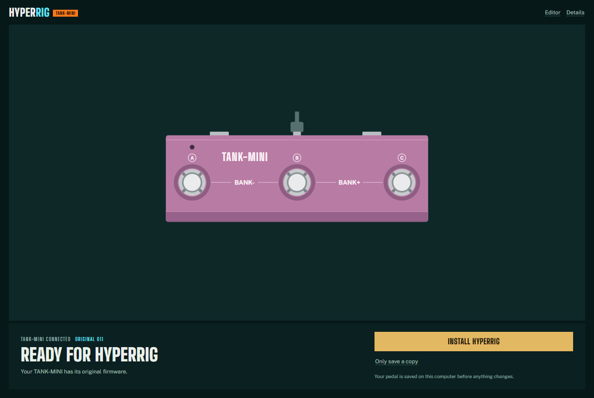

# Install HyperRig on your TANK-MINI

You need a Windows 10 or 11 PC (64 bit), a TANK-MINI with the original firmware **011**
(update it with M-Upgrade first if it has another), and a USB cable that carries data.
TANK-G and TANK-B need other firmware: do not use this one on them.

## 1. Download

From [Releases](https://github.com/danmigdev/hyperrig/releases) take
`HyperRig-<version>-Windows-x64.zip`, right-click it, **Extract all**, and start
`HyperRig.exe` in the folder that comes out. Keep the folder together; nothing is installed
on the computer.

The program is not signed. If Windows says it protected your PC: **More info**, then **Run
anyway**. `SHA256SUMS` beside the download says whether the file is whole.

## 2. Connect

Close M-Upgrade, music programs and other editors. Connect the pedal **straight to the
computer, not to a hub**, and switch it on.

## 3. Install

*The installer with a simulated pedal.*

1. Press **Install HyperRig on a pedal** in the bar, or the gear, **Firmware**, **Install,
   update or restore**. The program says which firmware the pedal has.
2. Press **Install HyperRig**. It first saves the whole pedal on your computer and checks the
   copy, then writes HyperRig and checks every byte.
3. It takes about two minutes. **Leave the cable and the power alone.**
4. **Open the editor**, and play.

HyperRig keeps its presets where the original firmware has its amp models, cabs and presets.
They are in the copy and come back with the original.

The copies are in `%APPDATA%\HyperRig\pedals`. **Keep them**: they are the way back, and they
are only for this pedal. Do not send them to anyone.

## Update

Start a newer HyperRig program and connect the pedal. It says **Update your pedal?**; press
**Update now**, then **Update HyperRig**. Your presets stay. Until then the editor only looks.

## Back to the original

The gear, **Firmware**, **Install, update or restore**, then **Restore the original firmware**.
The pedal is as it was when you installed HyperRig, with its amps, cabs and presets.

**Export your HyperRig presets first** (the buttons above the list of presets in the editor) if
you want them again. What is on the pedal is saved on the computer as well, but the program has
no button that puts that copy back.

## If something is wrong

- **The pedal is not found:** another cable, another USB port of the computer, and no program
  that uses the pedal; then switch it off and on.
- **The editor only looks:** the pedal has another version of HyperRig. Update it.
- **"Let's finish the job":** the last installation was interrupted. Press **Continue**.
- **The pedal does not start after an installation:** connect it straight to the computer, switch
  it off and on, and open the program. If it says **Let's finish the job**, press **Continue**. If
  it does not find the pedal, keep the copies in `%APPDATA%\HyperRig\pedals` and
  [open an issue](https://github.com/danmigdev/hyperrig/issues/new/choose). The chip has an update
  mode of its own, but this program has no way into it, and nothing here is guaranteed.
- **Anything else:** [open an issue](https://github.com/danmigdev/hyperrig/issues/new/choose).
  What the program wrote down is in `%APPDATA%\HyperRig\logs`; look at it before you send a
  part of it.
