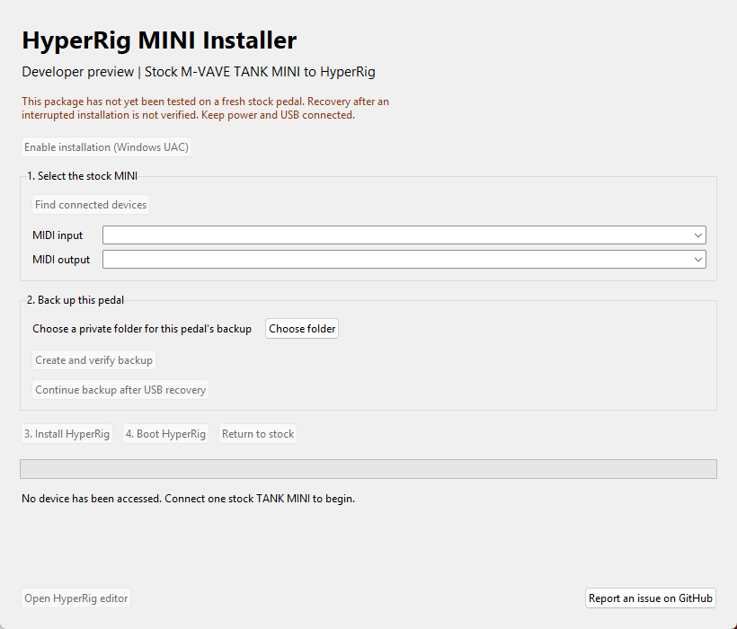
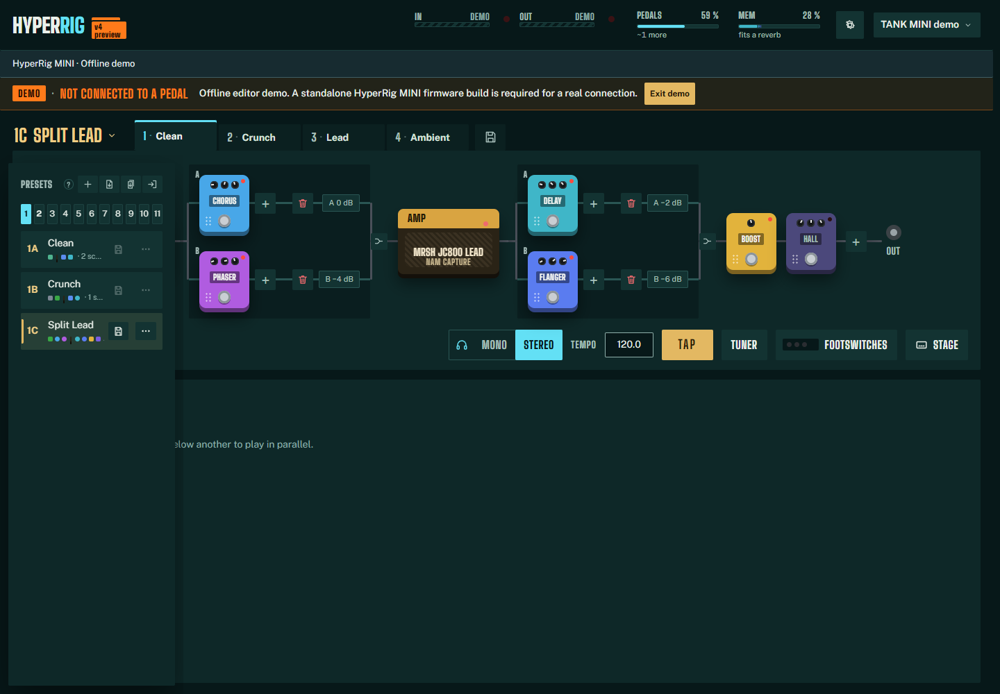

# Install HyperRig on your TANK MINI

**Windows developer preview for M-VAVE TANK MINI with stock firmware `TANK MINI_009`.**
One assisted installation has completed. Installation on other units and recovery
after an interrupted write are not yet qualified. Use this preview with maintainer
support. TANK-G and TANK-B require different firmware.

You need a 64-bit Windows PC, a USB **data** cable, stable pedal power, and Edge or
Chrome. The Windows download includes the firmware, installer and editor; you do
not need Python, a Raspberry Pi, or to open the pedal.

## 1. Download and open

Open [Releases](https://github.com/danmigdev/hyperrig/releases) and download
**`HyperRig-MINI-<version>-Windows-x64.zip`** from the selected preview's Assets.
The `source.zip`, `firmware.zip` and APK are not the Windows installer. If no
preview is published yet, use the preview ZIP supplied by the maintainer.

Right-click the ZIP, choose **Extract All**, and open the extracted folder.
Double-click **`HyperRig-MINI-Installer.exe`**. Keep all the extracted files
together. Opening the app does not start installation.

*Installer screenshot with no device connected. Device actions are disabled for
this documentation capture; the backup label is generic.*

## 2. Connect and back up

1. Close other pedal editors. Power on one MINI **without pressing footswitches**
   and connect its USB data cable.
2. Click **Enable installation (Windows UAC)** and accept the Windows prompt.
   In the new window, click **Find connected devices** and select the MINI's
   MIDI input and output.
3. Choose a private backup folder, then click **Create and verify backup**.
   Leave USB and power connected while the app reads two complete copies of the
   pedal's flash. This takes several minutes; wait for the verified result.
4. Keep the whole backup folder and a second copy somewhere safe. It belongs to
   this exact pedal. Do not upload it or use another pedal's backup.

The installer rejects unsupported stock firmware and mismatched backups.
Stock preset conversion to HyperRig presets is not qualified.

## 3. Install and boot

Click **3. Install HyperRig**, then **Yes** to replace the stock application.
Keep power and USB connected until the status says **Ready to boot**. The app
verifies the complete written image before enabling the next step.

Release all footswitches and click **4. Boot HyperRig**. Wait for
**HyperRig USB detected**.

## 4. Open the editor

Click **Open HyperRig editor**. In Edge or Chrome, click **Connect**, choose USB
if asked, and select the MINI's **USB Serial Device (COM...)**. The COM number
depends on your PC. Keep the installer window open: it serves the editor locally.

You should see **MINI v4 preview**, the pedal's data, and preset slots **A/B/C**
in each bank. Each preset still has four scenes. The final bank has two slots,
preserving all 32 device preset IDs.

*Offline demo with example data, not a connected pedal. Demo exposes controls
beyond the currently qualified hardware feature set.*

Connect an instrument and check the audio. V4 audio listening and complete
physical switch/LED mapping remain untested. **Footswitches** and **Stage** are
disabled on the connected MINI. USB effect controls and preset/scene saves are
enabled within the [reviewed v4 scope](docs/MINI_V4_EDITOR.md).

## Next time

If HyperRig is already installed, open **`launch_editor.cmd`** from the Windows
package, then connect in the browser. You do not need another backup or firmware
installation just to use the editor. Use one connected editor window at a time.

## Android editor

Download **`HyperRig-MINI-<version>-Android.apk`** from the same preview and open
it on Android 7 or later. Allow installation from that source if Android asks.
Open HyperRig MINI and use **Connect** to select the pedal over Bluetooth.

The APK is an editor for a MINI already running HyperRig. Firmware installation
uses the Windows app. **Bluetooth reads only:** Android writes remain disabled,
and this APK has not been tested on a physical phone. You can use Demo offline.

## If something stops

| What you see | What to do |
| --- | --- |
| No MINI in the device list | Check pedal power and a USB data cable. Close other editors and click Find connected devices again. |
| Stopped or a Windows USB error during backup entry | Keep the backup folder. Ask the maintainer to review the recorded session and recover USB. Only then use Continue backup after USB recovery when offered. |
| An error after installation has started | Keep power connected and retain the report. Ask the maintainer before retrying, resetting or booting. Interrupted-write recovery is not verified. |
| Browser remains at Checking | Close other connections to the MINI. If it does not finish, report the exact message; do not reinstall firmware just to fix an editor connection. |
| Install or Boot is disabled | The preceding backup or full verification has not passed yet. |

**Return to stock** only exits before firmware writing, after checking the stock
bytes are unchanged. It is not a post-installation restore button.

[Report an issue](https://github.com/danmigdev/hyperrig/issues/new/choose).
Review the issue yourself; nothing is uploaded automatically. Keep backups,
presets and personal paths out of the report.

[Assisted installation evidence](docs/MINI_INSTALLER_USB_CONTINUATION.md) |
[Installer details](docs/MINI_INSTALLER_PREVIEW.md) |
[Release build instructions](docs/RELEASE_BUILD.md)
