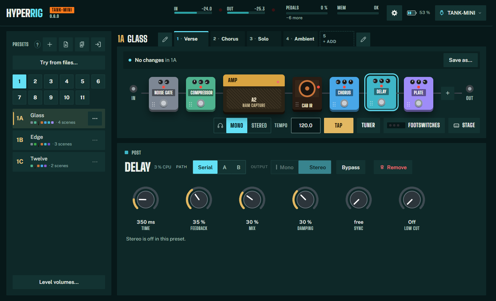

# HyperRig

Firmware, editor and installer for the **M-VAVE TANK-MINI**, independently maintained and
based on UltraRig.

[Install it](INSTALLATION.md) | [Manual](docs/MANUAL.md) | [What is new](docs/CHANGES.md) |
[Downloads](https://github.com/danmigdev/hyperrig/releases) |
[Report an issue](https://github.com/danmigdev/hyperrig/issues/new/choose)

*The editor with a simulated pedal.*

## What it does

- **Your own chain.** 45 kinds of blocks in series or in two paths, and a NAM amp capture
  between them.
- **32 presets, eight scenes in each.** A scene changes knobs and switches blocks without a gap.
- **Your footswitches.** Presets, Stomp or Scenes, or any action on each switch. A switch held
  or pressed can move a knob, up and back, in the time you give it.
- **Acoustic.** A block that makes an acoustic guitar of an electric one, with 6 or 12 strings.
- **Harmonizer and Pitch Glide.** One or two voices that follow your notes in the key and the scale
  of the song, or one that slides up to two octaves up or down while you stand on a switch.
- **Captures and cabs.** 15 NAM captures and 8 cab IRs in the pedal, from files or straight from
  [TONE3000](https://www.tone3000.com). Powered by TONE3000.
- **Presets of others.** From [Patchstorage](https://patchstorage.com/platform/hyperrig/), heard on
  the pedal before you keep them. A backup of the whole pedal in one file.
- **One program.** The editor finds the pedal by itself over USB; the installer is in it. No
  administrator rights, no drivers, nothing else to install.
- **The way back.** Before anything changes the whole pedal is saved on your computer, and the
  original firmware comes back from that copy as it was, with its amps and presets.

## Start

1. Download `HyperRig-<version>-Windows-x64.zip` from
   [Releases](https://github.com/danmigdev/hyperrig/releases) and extract the whole of it.
2. Start `HyperRig.exe` and connect the pedal by USB, straight to the computer.
3. Follow the [installation guide](INSTALLATION.md).

## What it was tried on

One TANK-MINI. On it: the whole pedal saved from the original firmware 011, HyperRig
installed, the original brought back byte for byte, HyperRig updated to a newer one, and
then played. HyperRig is installed from 011 only, and no second pedal was tried.
What is not there and what was not tried is in the [manual](docs/MANUAL.md#limits).

Installing HyperRig replaces the firmware of the pedal, at your own risk and without any
warranty.

## Privacy

No telemetry, no donations, no automatic reports. The program sends nothing over the
network, except to TONE3000 when you open Browse TONE3000, and to Patchstorage when you open
Browse Patchstorage. Reporting an issue opens GitHub,
where you look at it and send it yourself.

## Licence

**Noncommercial use only.** HyperRig is under the
[PolyForm Noncommercial License 1.0.0](LICENSE.md), as UltraRig is, on which it is based; the
parts of others keep their own licences. [The notice](release/NOTICE.md) says what is in it and
whose it is. HyperRig is not affiliated with M-VAVE, with UltraRig's author or with TONE3000.

## For developers

- [How a release is built](docs/RELEASE_BUILD.md), from source, byte for byte the same anywhere.
- The firmware: [its source](docs/ULTRARIG_SOURCE.md), [what HyperRig adds](docs/MINI_PRODUCT.md),
  [the acoustic block](docs/MINI_ACOUSTIC.md), [the harmonizer](docs/MINI_HARMONIZER.md), [MIDI](docs/MINI_MIDI.md), [the same volume](docs/MINI_LOUDNESS.md), [the loader](firmware/mini_stage/README.md).
- [The editor](docs/MINI_DEV_EDITOR.md), [the desktop program](docs/DESKTOP_EDITOR.md),
  [the installer](docs/INSTALLER.md).
- [Where everything comes from](docs/PROVENANCE.md).

A document that a comment in the source names and that is not here is a working note, which is not
published.
