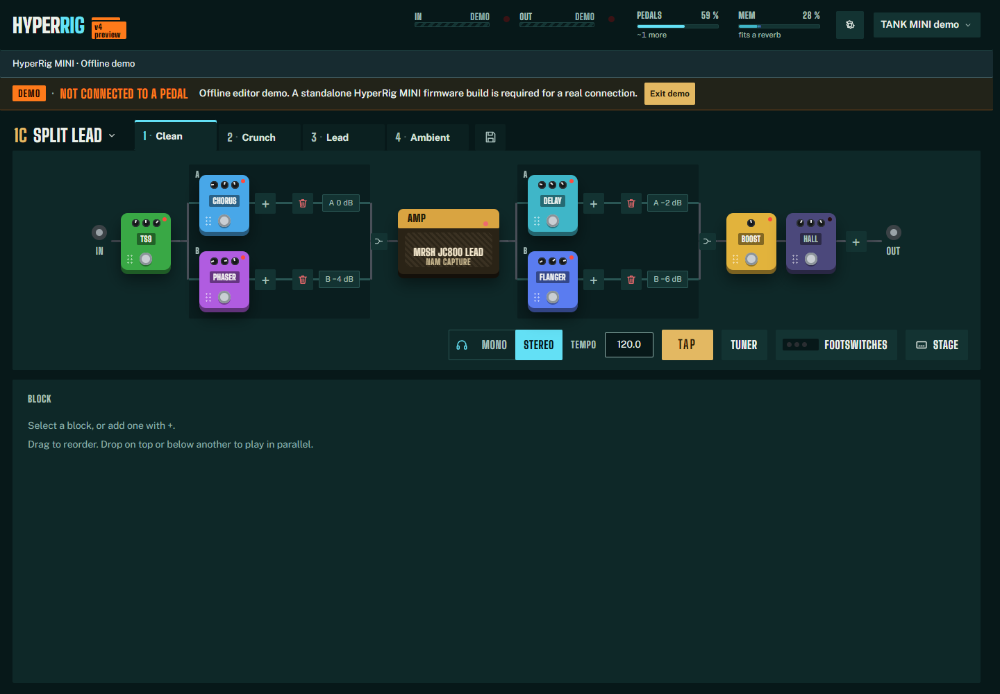

# HyperRig

Firmware and editor for the **M-VAVE TANK MINI**, independently maintained and
based on UltraRig.

[Installation guide](INSTALLATION.md) |
[Downloads](https://github.com/danmigdev/hyperrig/releases) |
[Build release artifacts](https://github.com/danmigdev/hyperrig/actions/workflows/release.yml) |
[Report an issue](https://github.com/danmigdev/hyperrig/issues/new/choose)



*Real editor screenshot using the offline demo and example data. Demo controls
are broader than the currently qualified hardware feature set.*

## Start here

1. Download **`HyperRig-MINI-<version>-Windows-x64.zip`** from the selected preview
   in Releases. If no preview is published yet, use the maintainer-supplied ZIP.
2. Extract the whole ZIP and open **`HyperRig-MINI-Installer.exe`**.
3. Follow the [illustrated installation guide](INSTALLATION.md): connect, back
   up your pedal, install, boot, then open the editor.

The Windows package includes everything needed for installation and USB editing.
No Python installation or Raspberry Pi is required. If HyperRig is already on
your pedal, open **`launch_editor.cmd`** and connect; do not reinstall firmware.

| Platform | Available in this preview |
| --- | --- |
| Windows x64 | USB firmware installer, per-pedal verified backup and USB editor. |
| Android 7+ | Signed editor APK; Bluetooth reads only. Does not install firmware. |
| Edge / Chrome | Standalone web editor; localhost launcher included in its ZIP. |

## What works, and what is still a preview

The current target is **stock TANK MINI_009**. The editor shows **MINI v4 preview**,
three preset slots per bank (**A/B/C**), 32 total preset IDs and four scenes per
preset. USB gain, preset/scene operations and effect add/change/bypass/remove
are enabled within the [reviewed v4 scope](docs/MINI_V4_EDITOR.md).

One development MINI completed a GUI installation from restored stock with
verified full readback and working USB editor data. That trial required separate
USB hub recovery and the backup continuation step. **Independent installation
and interrupted-write recovery remain unqualified.** V4 audio listening, the
complete physical switch/LED mapping, and this APK on a physical Android phone
remain untested. Bluetooth mutations, routing and panel remapping are disabled;
**Footswitches** and **Stage** are disabled on the connected MINI.

The complete original firmware C project has not been recovered. The release
packages a pinned binary port, preserving its tested firmware bytes and command
policy. The [GitHub workflow](docs/RELEASE_BUILD.md) builds the Windows executable,
Android APK, web package, firmware package, source archive and checksums from one
commit, then optionally prepares a **draft prerelease** for review.

[Installation trial](docs/MINI_INSTALLER_USB_CONTINUATION.md) |
[V4 upgrade and recovery observations](docs/MINI_ONE_SWITCH_UPGRADE.md) |
[Earlier v3 audio/editor evidence](docs/MINI_INTEGRATED_PORT.md) |
[Goal and remaining work](docs/HYPERRIG_GOAL.md)

## Privacy and licenses

No telemetry, donations or automatic report uploads. Reporting opens GitHub so
you can review and submit the issue yourself. Device backups, user presets,
signing keys and generated build packages stay out of Git.

HyperRig preserves original authorship, component licenses and required notices.
All maintained interface text and documentation is in English. Original source
records and protocol identifiers are preserved; see [AGENTS.md](AGENTS.md).

## Development and reverse engineering

Current priority: [reverse engineering for backports](docs/REVERSE_ROADMAP.md).
The [switch transition core](docs/CONTROL_RECONSTRUCTION.md) has a portable C
reconstruction with 15,520 comparisons against original instructions. The
[action dispatcher and timers](docs/CONTROL_ACTIONS.md) add 10,101 comparisons.
[Preset/scene selection and effect binding](docs/SELECTION_RECONSTRUCTION.md)
add nine reconstructed functions and 14,631 comparisons, including integrated
event sequences. [Preset availability and record validation](docs/PRESET_STORAGE_RECONSTRUCTION.md)
add seven functions and 2,312 comparisons covering address mapping, CRCs, cached
failures and record reads. [Preset preflight and legacy conversion](docs/PRESET_PREFLIGHT_RECONSTRUCTION.md)
add three functions and 1,754 comparisons covering old layouts and effect
parameters. [Preset loading, bindings and reports](docs/PRESET_LOADER_RECONSTRUCTION.md)
add eight functions and 4,635 comparisons, connecting controls through preflight
and the loader. [Asset checks and application layouts](docs/PRESET_ASSETS_RECONSTRUCTION.md)
add nine dependencies and 3,938 comparisons. Alongside the existing A2 engine,
[two recursive DSP filters](docs/BIQUAD_RECONSTRUCTION.md) add 1,864 comparisons
covering rounding, fractional carry, clipping and history across blocks.
The [IR loader and ownership helpers](docs/IR_LOADER_RECONSTRUCTION.md) add five
functions and 541 comparisons, including reuse, full record checks and cleanup.
The [five-section DSP chain](docs/BIQUAD_CHAIN_RECONSTRUCTION.md) adds two functions
and 2,445 comparisons, executing both filters and preserving history during updates.
The [capture loader and gain metadata](docs/CAPTURE_LOADER_RECONSTRUCTION.md)
add ten functions and 6,091 comparisons for reuse, signature rejection and partial
rollback. [Coefficient staging and conversion](docs/BIQUAD_COEFFICIENT_RECONSTRUCTION.md)
add 11,071 instruction comparisons and 6,912 independent binary32 division checks.
The [capture container and record reader](docs/CAPTURE_CONTAINER_RECONSTRUCTION.md)
add 262 comparisons, including integrated slot loading and failure cleanup.
The [metadata journal/cache](docs/CAPTURE_METADATA_RECONSTRUCTION.md) add 9,764
comparisons. The [bounded coefficient generator](docs/BIQUAD_GENERATOR_RECONSTRUCTION.md)
adds 5,542 instruction comparisons, executing all mathematical dependencies through
staging, with 18,069 independent binary32 arithmetic checks.
The [capture DSP dispatch](docs/CAPTURE_DISPATCH_RECONSTRUCTION.md) adds 1,847
comparisons through preparation, size queries, DSP setup and recovery.
[Journal writes and verification](docs/CAPTURE_JOURNAL_RECONSTRUCTION.md) add
655 comparisons with synthetic storage. The [integrated filter pipeline](docs/BIQUAD_PIPELINE_RECONSTRUCTION.md)
adds 1,698 comparisons from parameter requests through sample processing.
The [whole native capture parser](docs/CAPTURE_PARSER_RECONSTRUCTION.md) adds
424 comparisons, and [capture memory reset](docs/CAPTURE_RESET_RECONSTRUCTION.md)
adds 253 through direct and container-loading paths. The
[complete metadata command](docs/CAPTURE_COMMAND_RECONSTRUCTION.md) adds 1,114
comparisons through parsing, reload, retries and gain updates. The
[DSP initializer and guarded startup](docs/DSP_INITIALIZATION_RECONSTRUCTION.md)
add 4,529 comparisons through the recovered coefficient producer.
The [integrated native capture loader](docs/CAPTURE_NATIVE_RECONSTRUCTION.md)
now executes the real parser and reset through installation and recovery, adding
273 comparisons. The [native capture processing caller](docs/CAPTURE_PROCESSING_RECONSTRUCTION.md)
adds 230 comparisons with actual numerical kernels. [DSP dynamics setup](docs/DSP_DYNAMICS_RECONSTRUCTION.md)
adds 2,930 comparisons through startup, and [IR installation](docs/IR_INSTALLATION_RECONSTRUCTION.md)
adds 1,143 through gain, trimming, storage reads and ownership transitions.
[Native warm-up](docs/CAPTURE_WARMUP_RECONSTRUCTION.md) adds 216 comparisons.
[Live capture integration](docs/CAPTURE_LIVE_RECONSTRUCTION.md) now carries the
actual loaded context through warm-up and processing, adding 695 comparisons
and support for the parser's small head rings. [Startup input and the four-section
sample path](docs/DSP_AUDIO_PATH_RECONSTRUCTION.md) add 1,914 comparisons with
actual filter and gain-ramp execution.
[Four-section parameter transitions](docs/DSP_TRANSITION_RECONSTRUCTION.md)
add 1,812 comparisons from real requests and coefficient generation through
sample processing, including complete 1,020-step transitions.
[IR convolution construction](docs/IR_CONVOLUTION_RECONSTRUCTION.md) adds 14
function regions and 479 comparisons through resampling, FFT, fixed-point packing
and object publication. The [IR runtime](docs/IR_PROCESSING_RECONSTRUCTION.md)
adds sixteen function regions and 399 comparisons through actual constructor
objects, software FFT/convolution, gain ramps and accelerator control. Register
responses and accelerator output are explicitly simulated.
The [complete preset application](docs/PRESET_APPLICATION_RECONSTRUCTION.md)
adds seven function regions and 1,775 comparisons through effect reuse/rebuild
and asset decisions, retaining explicit downstream services. The
[dynamics sample processor](docs/DSP_DYNAMICS_PROCESSING_RECONSTRUCTION.md)
adds five regions and 756 comparisons, connecting configuration and startup
to actual 128-sample processing, retained history and meter updates.
The [complete audio task](docs/AUDIO_TASK_RECONSTRUCTION.md) adds six regions
and 317 comparisons, joining the recovered filters, dynamics and capture warm-up
on shared native state. Its recording FIR, queue handling and bounded task
continuations are verified; unrecovered sample and platform services remain
explicit dependencies.
The [scene application](docs/SCENE_APPLICATION_RECONSTRUCTION.md) adds three
regions and 561 comparisons, joining direct/pending selection to actual scene
application, parameter transitions and reporting. Effect services remain
explicit boundaries. The [transition notification](docs/DSP_TRANSITION_NOTIFICATION_RECONSTRUCTION.md)
adds one region and 918 comparisons through the installed callback and gain
mixer, including shared-state callback mutations.
The [asynchronous capture path](docs/CAPTURE_ASYNC_RECONSTRUCTION.md) adds four
regions and 137 comparisons through the real wrapper, worker and numerical
processing, including audio-task integration and exact timeout/fallback replay.
Scheduling and accelerator completion remain controlled offline fixtures.
The [DSP stage and routing](docs/DSP_STAGE_RECONSTRUCTION.md) add sixteen
regions and 806 comparisons through automation, branch alignment, Q28 filters,
mixing and the audio task. Seven unreachable empty-group instructions remain
explicitly classified; individual/grouped effect bodies remain services in that
stage-only corpus.
The [effect resampling](docs/EFFECT_RESAMPLING_RECONSTRUCTION.md) recovers six
functions with 1,563 comparisons and carried history. The
[enable/fade handlers](docs/EFFECT_ENABLE_RECONSTRUCTION.md) add thirteen
functions and 2,941 comparisons, including the actual installed clear callback.
[Parameter support](docs/EFFECT_PARAMETER_SUPPORT_RECONSTRUCTION.md) adds nineteen
functions and 4,250 comparisons for packing, tempo, memory moves and division.
The [effect processing callers](docs/EFFECT_PROCESSING_RECONSTRUCTION.md) add
sixteen functions and 4,664 comparisons, joining the dispatcher, individual/group
processing, actual resampling and IR execution to the stage and audio task.
Five invariant instruction gaps and explicit effect-specific numerical services
remain documented. [Parameter updates](docs/EFFECT_PARAMETERS_RECONSTRUCTION.md)
add seven functions and 5,679 comparisons for immediate changes, automation
production, classification and resource probing, with actual scene callers and
DSP automation consumption.
[Parameter resources](docs/EFFECT_PARAMETER_RESOURCES_RECONSTRUCTION.md) add
nineteen functions and 2,850 comparisons for allocation/recovery, packed history,
state fingerprints, mode changes and IR lengths. All 579 new instructions are
visited; allocator internals and complete slot removal remain explicit services.
[Effect construction](docs/EFFECT_CONSTRUCTION_RECONSTRUCTION.md) adds fourteen
functions, while [signal processing](docs/EFFECT_SIGNAL_RECONSTRUCTION.md) adds
the all-pass, gate and state-variable filter. The
[parameter/resource integration](docs/EFFECT_PARAMETER_LIFECYCLE_RECONSTRUCTION.md)
executes actual recovery and migration through the parameter callers.
[Effect ownership](docs/EFFECT_OWNERSHIP_RECONSTRUCTION.md) adds eight functions
for route/queue cleanup and resource release, preserving callback order.
[Resource/ownership integration](docs/EFFECT_RESOURCE_OWNERSHIP_RECONSTRUCTION.md)
executes that teardown through allocation recovery and parameter/scene callers,
including the retained failure prefix.
[Constructor-to-signal integration](docs/EFFECT_CONFIGURED_SIGNAL_RECONSTRUCTION.md)
carries actual generated parameters into three numerical engines, stage
processing and audio-task observations. Together these integrations add 1,965
original-instruction comparisons without adding function entries.
[IR effect lifecycle](docs/IR_EFFECT_LIFECYCLE_RECONSTRUCTION.md) adds nine
functions and 808 comparisons for source selection, temporary installation,
rollback, ownership and relocation, visiting all 422 new instructions.
[Effect model construction](docs/EFFECT_MODEL_CONSTRUCTION_RECONSTRUCTION.md)
adds 49 functions and 1,657 comparisons, closing all six numerical builder
dependencies in the main constructor. Five statically unreachable instructions
remain distinct from executed coverage.
The [audited inventory](docs/REVERSE_INVENTORY.md) now records 389 reconstructed
function regions across 54 reports, with 102 unreconstructed direct dependency
targets. Candidate entries are separate evidence; a firmware-wide completion
percentage is not yet established.
Physical storage I/O and live preset/DSP application remain explicit boundaries.
These are development components; the installed firmware and qualification of
physical controls are unchanged.

The repository includes parsers for SFC/JLFS/FWSC and A2L1, extracted-protocol
analysis, binary port builders, reconstructed C components, tests, board
profiles, and hardware investigation records.

Python 3.12 is needed to read the original installer's Python 3.12 bytecode.
Offline parsers use only the standard library.

```powershell
python tools/bootstrap.py
python tools/fetch_artifacts.py
python -m hyperrig analyze
python tools/disassemble.py
python tools/map_audio.py
python -m hyperrig port-status
```

Ghidra decompilation requires Java 21 or later and Ghidra 12.2. The optional
bootstrap downloads about 570 MB and installs the JieLi processor module into
the local Ghidra copy:

```powershell
python tools/bootstrap.py --decompiler
powershell -NoProfile -ExecutionPolicy Bypass -File tools/decompile.ps1 -Target tank-mini
```

Other targets are `tank-g-v1`, `tank-g-v2`, `tank-b-v1`, and `tank-b-v2`.
ExecutionPolicy applies only to that process. Analysis tools do not run the
pedal installers.

Building the reconstructed C components on Windows requires WSL Ubuntu with
GCC and Python 3:

```powershell
python tools/bootstrap.py --toolchain
python tools/build_native.py
```

This produces `build/native/hyperrig_dsp.pi32v2.o` and local verification
evidence, not a flashable firmware image. Documented DSP checks include
**7,509 comparisons against interpreted original instructions**. The working
binary port and the separate portable C engine have different completion
states; their evidence is documented separately.

Historical hardware-proof builders pin the exact source bytes used for their
tests. Reproduce those results from the recorded Git revision; translations
and later UI changes do not rewrite historical evidence.

## Local artifacts

| Path | Contents |
|---|---|
| `recovered/ultrarig-original/web/` | Original editor HTML/JavaScript and NAM converter |
| `recovered/android/` | Original APK assets and configuration |
| `recovered/installer/` | Installer bytecode, disassembly, and constants |
| `recovered/ghidra/<target>/decompiled.c` | Inferred, non-buildable C pseudocode |
| `analysis/firmware/<image>/` | Decoded binaries, maps, assembly, and captures |
| `analysis/tank-mini/` | Official MINI firmware analysis |
| `artifacts/` | Original packages and local device backups |
| `upstream/` | Reference repositories and SDK headers |
| `build/` | Generated firmware, editors, and test artifacts |

Recovered binaries, full device dumps, user presets, and generated builds
remain local and are excluded from Git. The repository versions tools,
tests, profiles, documentation, and selected evidence/source snapshots.
Historical G/B packages in `build/hyperrig/` are separate from the current
MINI product and must not be used as MINI installers.

## Documentation

- [Goal and remaining work](docs/HYPERRIG_GOAL.md)
- [Reverse engineering and verified results](docs/REVERSE_ENGINEERING.md)
- [Local sources and modification paths](docs/LOCAL_SOURCES.md)
- [Integrated MINI port](docs/MINI_INTEGRATED_PORT.md)
- [MINI board profile and porting constraints](docs/PORTING_TANK_MINI.md)
- [Reconstructed native C and numerical verification](docs/NATIVE_RECONSTRUCTION.md)
- [MINI audio path](docs/TANK_MINI_AUDIO.md)
- [MINI audio driver](docs/MINI_AUDIO_DRIVER.md)
- [Startup, linker, and diagnostics](docs/MINI_BOOT.md)
- [ROM probe](docs/MINI_ROM_PROBE.md)
- [Synthetic A2L engine in RAM](docs/MINI_ROM_ENGINE.md)
- [Complete UltraRig application port](docs/MINI_ULTRARIG_PORT.md)
- [Editor architecture](docs/MINI_APP.md)
- [ROM recovery](docs/MINI_RECOVERY.md)
- [Complete NOR backup](docs/MINI_FLASH_BACKUP.md)
- [Bootloader handover](docs/MINI_HANDOVER.md)
- [Clocks and sampling](docs/MINI_CLOCK.md)
- [Image validation](docs/MINI_IMAGE.md)
- [Watchdog, clocks, and cache](docs/MINI_PLATFORM.md)
- [Codec and mute](docs/MINI_CODEC.md)
- [Interrupts and audio worker](docs/MINI_RUNTIME.md)
- [Historical package branding](docs/REBRANDING.md)
- [Provenance and licenses](docs/PROVENANCE.md)
- [Pinned tools and sources](research/sources.lock.json)

HyperRig is a derivative project. Original authorship, required notices, and
component licenses are preserved. The new name does not change those licenses.
